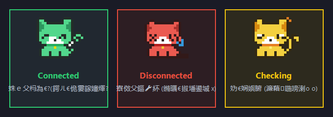

<div align="center">

# 🐾 Heartbeat-Cat (心跳猫猫)

**专为 Clash Verge / 代理打造的 Windows 任务栏「像素猫猫」实时连通性监控工具**

[](https://github.com/tianchaoyamen/Heartbeat-Cat)
[-orange?logo=windows)](https://github.com/tianchaoyamen/Heartbeat-Cat/releases)
[-brightgreen)](https://github.com/tianchaoyamen/Heartbeat-Cat)
[](https://github.com/tianchaoyamen/Heartbeat-Cat/releases)
[](LICENSE)

<br/>



<br/>
<br/>

经常在使用 Clash Verge 等代理时突然断网却毫无察觉？  
**Heartbeat-Cat** 在 Windows 右下角任务栏安插了一只敏锐可爱的**像素小猫猫**，时刻帮你盯着代理连接心跳！

</div>

---

## ✨ 核心特性

- 🐱 **精准复刻经典原版像素猫视觉设计**
  - 🟢 **正常连通 · 动态招财猫**：经典原画银灰毛色（`#C3C4C6`）、纯白口鼻与爪尖、宝蓝项圈（`#4E71FF`）与黄金铃铛。小肉爪欢快挥动并开心眨眼，**尾巴安静伫立**，辨识度极高，一眼便知节点畅通！
  - 🔴 **异常断开 · 晕倒红猫猫**：警示珊瑚红，耳朵耷拉折起，双眼打叉晕倒 `x x`，脸颊挂着大滴眼泪 💧，尾巴垂下，瞬间警觉！
  - 🟡 **检测等待 · 歪头黄猫猫**：温暖金黄，大圆眼 `o o` 好奇四顾，头顶顶着小问号标识。

- ⚡ **独立 EXE 打包，彻底脱离 VBScript 依赖**
  - 针对 Windows 11 等现代系统逐步废弃 VBScript 的情况，提供专用原生的独立可执行文件 **`HeartbeatCat.exe`**。
  - **无需安装任何第三方环境**（免 Python、免 Node.js，无需 VBScript 脚本宿主）。
  - 内置原生 Windows Forms 渲染引擎与低内存网络探针，无黑框 CMD 闪烁，开机后台自启无忧，内存占用仅约 **15~20 MB**，CPU 消耗趋近于 **0%**。

- 🛡️ **工业级防崩溃、防闪退与句柄保护 (24/7 长期守护)**
  - **网络连接池严格清理**：每个探针请求严格释放底层 Socket、TCP 句柄与 Stream，杜绝长期运行导致的资源耗尽。
  - **系统内核级独占文件锁**：替代易在非管理员或异常中断时死锁的传统 Mutex，进程被杀由 OS 内核自动回收，杜绝多实例竞争。
  - **多层异常全熔断保护**：定时器、网络 IO 与气泡通知均配备全链路异常拦截，网络波动绝不导致程序崩溃。

- 🔕 **智能通知延时防抖**
  - 网络经常闪断 1~2 秒就恢复？频繁弹窗很扰民！
  - **默认 5 秒延时防抖**：短于 5 秒的瞬时闪断静默处理（猫猫变红但系统不弹窗骚扰）；仅在断线持续超过 5 秒时才弹出 Windows 系统通知，节点恢复后同样发出温馨恢复提示。

- 🎛️ **便捷托盘右键菜单**
  - 实时显示当前连通状态与延迟数值（毫秒）。
  - 支持 **「开机自动启动」**：右键菜单直接勾选即可开启自启，取消勾选即可关闭，开箱即用。
  - 支持 **「立即检测」**、**「修改配置 (config.json)」**、**「重新加载配置」**（无需重启程序）。

---

## 🚀 下载与使用

### 方式一：直接下载 Release 绿色版（最推荐，小白首选）

1. 前往 **[GitHub Releases 页面](https://github.com/tianchaoyamen/Heartbeat-Cat/releases)** 下载最新版 `HeartbeatCat-v1.0.0-windows-x64.zip`。
2. 解压到任意你喜欢的文件夹中。
3. 双击运行 **`HeartbeatCat.exe`** 即可！

> 💡 **小贴士**：
> 如果右下角任务栏没有立刻看到猫猫，通常是因为被 Windows 折叠在向上的箭头 `^` 中。建议**鼠标左键拖动猫猫图标至任务栏外侧常驻显示**！

### 方式二：从源码编译或二次开发

本项目开源完整 C# 源码（`src/Program.cs`），所有 Windows 系统自带 .NET 编译工具，无需安装 Visual Studio：

```cmd
git clone https://github.com/tianchaoyamen/Heartbeat-Cat.git
cd Heartbeat-Cat
build.bat
```
执行 `build.bat` 即可一键生成最新的 `HeartbeatCat.exe`。

---

## ⚙️ 配置文件说明 (`config.json`)

程序启动后会自动在同级目录生成 `config.json`，可随时修改并右键托盘点击 **「重新加载配置」**：

```json
{
  "mode": "proxy",
  "proxy_host": "127.0.0.1",
  "proxy_port": 7897,
  "test_url": "http://www.gstatic.com/generate_204",
  "direct_host": "1.1.1.1",
  "direct_port": 443,
  "check_interval_seconds": 3,
  "timeout_seconds": 2,
  "show_notification": true,
  "notify_delay_seconds": 5,
  "animation_speed_ms": 400,
  "auto_start": false
}
```

### 参数详解

| 配置项 | 类型 | 默认值 | 详细说明 |
| :--- | :---: | :---: | :--- |
| `mode` | `string` | `"proxy"` | **`"proxy"`**：通过本地代理端口发包（最贴近实际翻墙体验）；<br/>**`"direct"`**：直连指定服务器 IP/域名做 TCP 握手。 |
| `proxy_host` | `string` | `"127.0.0.1"` | 代理客户端本地监听地址。 |
| `proxy_port` | `number` | `7897` | Clash 代理端口。Clash Verge / Verge Rev 默认为 `7897`，CFW 默认为 `7890`。 |
| `test_url` | `string` | `"http://www.gstatic.com/generate_204"` | 极轻量探测网址（HTTP 204 无内容极速返回，完全不耗流量）。 |
| `direct_host` | `string` | `"1.1.1.1"` | 当 `mode` 为 `"direct"` 时生效，指定要盯防的固定落地服务器。 |
| `direct_port` | `number` | `443` | 当 `mode` 为 `"direct"` 时生效的目标端口。 |
| `check_interval_seconds` | `number` | `3` | 检测间隔时间（秒）。 |
| `timeout_seconds` | `number` | `2` | 单次检测超时阈值（秒）。 |
| `show_notification` | `boolean` | `true` | 是否允许断网与恢复时弹出 Windows 系统通知气泡。 |
| `notify_delay_seconds` | `number` | `5` | **断网通知延时防抖（秒）**。断线持续超过此时间才弹窗，避免频繁闪断打扰。 |
| `animation_speed_ms` | `number` | `400` | 猫猫招手与眨眼动画帧切换间隔（毫秒）。 |
| `auto_start` | `boolean` | `false` | 是否开启开机自动启动（亦可在托盘右键菜单直接勾选切换）。 |

---

## 🛑 退出监控

- **推荐方式**：鼠标右键点击任务栏的小猫猫，在菜单中选择 **「退出监控」**。
- **命令行方式**：双击运行目录下的 **`stop.bat`**。

---

## 🛠️ 开机自启设置

程序已内置一键开机自启功能：
1. 鼠标右键点击右下角任务栏的猫猫图标。
2. 直接点击 **「开机自动启动」** 即可完成注册（会有系统气泡提示）。
3. 如需关闭，再次右键点击取消勾选即可。无需手动创建快捷方式或配置文件夹！

---

## 📄 开源许可证

本项目基于 [MIT License](LICENSE) 开源。欢迎 Star、Fork 与提 Issue！
